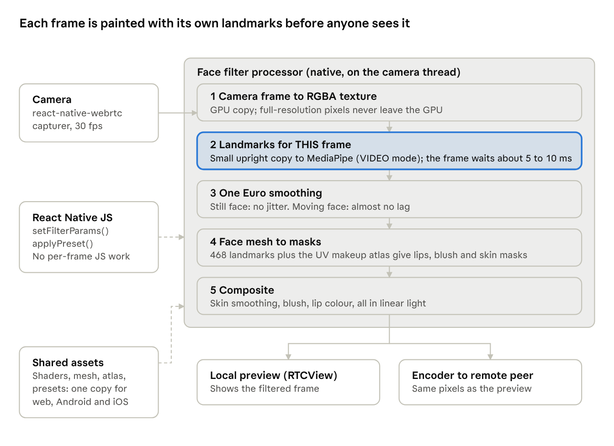
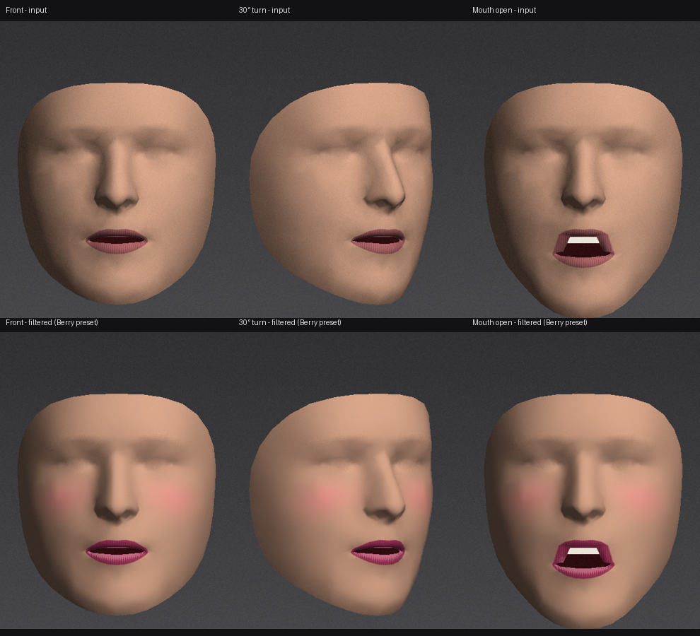

# Real-Time Face Filter Engine — Architecture & Build Plan

Exported from the design doc (Nov 26, 2026). Live version: https://claude.ai/artifact/BHzxqMA3Xj4CeNEdEXvJEN

## 1. Why your current filter lags

Your lips and blush trail the face because they are painted using landmarks from an older frame than the pixels underneath, and a smoothing step then delays them further. Paid SDKs do not have a magically faster model. They paint every frame using the landmarks of that exact frame, so the offset is zero by design.

"It lags for a few milliseconds, then snaps back onto the face" is the signature of causes 1 to 3 below. Most RN filter attempts have all three.

| # | Cause | What you see | Fix in this design |
| --- | --- | --- | --- |
| 1 | Filter drawn as a separate layer on top of the video view (Skia, SVG, Animated View) | Overlay trails by 1 to 4 frames (33 to 130 ms) on motion; the remote person may see no filter at all | Paint into the frame's pixels before the frame reaches the preview and the WebRTC encoder |
| 2 | Async inference (MediaPipe LIVE_STREAM, a worker, the JS thread) | Landmarks arrive after the frame is already on screen, so they are applied to a later frame | Synchronous VIDEO mode inside the frame processor: frame N waits for its own landmarks (5 to 12 ms) |
| 3 | Fixed-weight smoothing (lerp, EMA, moving average) | Smooth when still, but drags behind and then catches up when the head moves | One Euro filter: heavy smoothing at rest, almost none during fast motion |
| 4 | Per-frame JS or bridge hop, or full-resolution CPU conversion (toI420, Bitmap, base64) | 10 to 40 ms of variable delay, dropped frames, heat | GPU-only pixel path; only a small downscaled copy is read back for the model |
| 5 | Running face detection on every frame | Wasted 5 to 15 ms per frame | VIDEO mode carries tracking state from frame to frame instead of treating each frame as a new photo |

The trade-off the paid SDKs make, and this design copies: the outgoing frame is delayed by the inference time (about 10 ms), which nobody notices in a call with 100+ ms of network latency. In exchange, the makeup is locked to the face on every frame.

## 2. Quality targets

"Paid-grade" means zero frame offset, steady 30 fps for a whole call, and makeup that keeps the skin and lip texture visible. These are the numbers to hold every build to (section 11 says how to measure them). They are targets for this design, not measured results.

| Metric | Target (720p, 30 fps) |
| --- | --- |
| Frame offset between landmarks and painted pixels | 0 frames, always |
| Added processing time per frame | 12 ms or less on mid-range phones, 20 ms or less on low-end |
| Sustained frame rate | 30 fps for 45 minutes without dropping below 27 fps from heat |
| Landmark jitter, face still | Under 0.5 px RMS |
| Lip edge error, including fast head turns | Median 2 px or less, p95 4 px or less |
| Face lost and found again | Effect fades out and back in within 150 ms, no pop |
| Look | Lip lines and highlights show through the colour; no hard edge or halo; blush reads as pigment, not a pink sticker |
| Extra power draw | Filter adds 15% or less to the call's power draw |

## 3. Architecture

One native pipeline sits inside the camera capture path of react-native-webrtc. It finds the face, smooths it and paints the makeup on the GPU, then hands WebRTC a new frame. The local preview and the remote person receive identical, already-filtered pixels, and the overlay problem disappears because there is no overlay.



Step 2 is the design's key choice: the frame waits for its own landmarks. JS only swaps parameter snapshots, and every platform reads the same shaders, mesh and atlas.

| Layer | Web | Android | iOS |
| --- | --- | --- | --- |
| Camera in | getUserMedia + VideoFrame | Camera2 OES texture | CVPixelBuffer (NV12) |
| Landmarks | MediaPipe Tasks Web | MediaPipe Tasks Android | MediaPipe Tasks iOS |
| GPU | WebGL2 | OpenGL ES 3.0 | Metal |
| Shaders | shared GLSL | same GLSL files | Metal port of the GLSL |
| Out | canvas MediaStream | WebRTC TextureBuffer | RTCCVPixelBuffer |

## 4. Face tracking

Use MediaPipe Face Landmarker (478 3D landmarks) in VIDEO mode, called synchronously inside the frame processor on a small upright copy of the frame, then smooth with a One Euro filter. This is the same class of tracker the commercial SDKs ship; the difference is all in how it is wired.

### 4.1 Model and running mode

- Model: `face_landmarker.task`, `numFaces = 1` (one host per call), blendshapes off (turn on only for expression-driven effects), facial transformation matrix on (head pose for free).
- Running mode: VIDEO. It is synchronous, processes every frame in order and carries tracking across frames ([MediaPipe Face Landmarker](https://developers.google.com/edge/mediapipe/solutions/vision/face_landmarker)).
- Never LIVE_STREAM for in-frame effects. It is asynchronous with a result callback and drops frames when busy ([MediaPipe running modes](https://developers.google.com/edge/mediapipe/solutions/vision/face_detector)), which is exactly cause 2 in section 1.
- Delegate: GPU where stable (newer Android, all iOS, Chrome); CPU with XNNPACK as the fallback. Pick per device at first launch (section 10).

### 4.2 Preparing the model input on the GPU

Camera frames arrive sideways (sensor rotation 90 or 270) and mirrored on the front camera. The face detector expects an upright face, so a sideways frame silently fails or tracks badly.

1. One GPU pass samples the camera texture, rotates it upright and downscales it: long side 640 px for 720p and larger captures, 480 px below that.
2. Read back that small RGBA image (about 1.2 MB at 480x640; under 2 ms). The full-resolution frame never leaves the GPU.
3. Keep the 3x3 matrix `M` that maps upright-image coordinates back to camera-texture coordinates. Every landmark goes through `M` before rendering.

Why 640 is enough: the landmark model always works on a 256x256 crop of the face, so feeding it a 4K frame adds cost without adding precision.

### 4.3 Smoothing without lag (One Euro filter)

A One Euro filter is a low-pass filter whose cutoff rises with speed: strong smoothing when the face is still (no jitter), almost none when it moves (no lag). It is the standard answer to the "lags then snaps back" problem ([Casiez et al., CHI 2012](https://gery.casiez.net/1euro/)).

- Filter in face units, not pixels: divide coordinates by the inter-ocular distance, so one set of parameters works at every resolution and face size.
- Use speed = max(this landmark's speed, whole-face speed). Head motion then switches every point to low-lag mode together (the mesh never shears), while a mouth opening still unlocks the lip points on its own.
- Starting parameters (face units): `minCutoff 1.2 Hz`, `beta 8`, `dCutoff 1 Hz`, lips `minCutoff 3 Hz`, and a 0.35 face-units/s dead zone on each point's own speed so landmark noise does not open the filter. MediaPipe already applies its own temporal smoothing when `numFaces = 1`, so tune these on top of it with the jitter and motion tests in section 11.
- v1.1 upgrade: split rigid head pose from expression (fit a similarity transform to stable points such as nose bridge and cheekbones), filter the pose with low cutoff and the expression residual with high cutoff. This removes the last bit of "swimming".

### 4.4 Face lost and found

- Missing for 1 or 2 frames: reuse the last landmarks (covers single-frame dropouts).
- Missing longer: fade the effect out over 100 ms instead of popping off.
- Found again: reset the filters (so the makeup does not slide in from the old position) and fade in over 100 ms.

### 4.5 Low-end fallback

If the synchronous budget is blown even at 480 px, run inference one frame behind and extrapolate each landmark by its filtered velocity times the frame interval. This reintroduces a little error on sudden motion, so it is a last resort for the bottom device tier only.

## 5. Makeup rendering engine

Makeup is authored once as textures in the face's own UV space and drawn through a mesh built from the current frame's 468 landmarks. That is why it stays glued through head turns, expressions and perspective: the lipstick is a property of the mesh surface, not a sticker placed at a point.

### 5.1 UV-mapped face mesh

- MediaPipe's canonical face model ships UVs for all 468 vertices, and vertex i is landmark i. The kit's generator turns it into `face_mesh.json` (UVs plus triangles) for every platform.
- 46 of its 898 triangles cover the mouth opening and the eyes. Rendered as-is, they paint lipstick on teeth whenever the mouth opens. The generator removes them; the kit's render test checks teeth stay untouched.
- The mesh is drawn with depth (landmark z), so on a profile view the far cheek is hidden behind the nose instead of blush bleeding through.
- Output of this pass: one mask texture per frame. Red = lips, green = blush, blue = skin (face minus eyes, brows and lips).
- A new look is a new atlas painted over `uv_template.png` in Photoshop, plus a few numbers. No code change, so looks can be shipped from your server.

### 5.2 Render graph per frame

1. Camera frame to RGBA texture (Android OES copy; iOS NV12 to RGB; web direct upload).
2. Half-resolution copy, then a separable edge-preserving (bilateral) blur for skin smoothing. Radius scales with face size.
3. Quarter-resolution Gaussian: the local mean brightness used by the lip formula.
4. Face mesh with this frame's landmarks to the mask texture.
5. One full-resolution composite pass: skin, then blush, then lips.

Only passes 1, 4 and 5 touch every pixel, and pass 4 only touches the face. Everything runs in linear light, using fast sRGB conversions accurate to under 1%.

### 5.3 Lips: colour that keeps the lip's own texture

Cheap filters multiply a pink layer over the mouth, which flattens it into a sticker. This engine replaces the lip's colour and base brightness while keeping its fine detail (lines, creases, highlights) as a ratio to the local mean:

```
L_out   = mix(L_low, L_target, coverage) * (L / L_low) ^ texture
rgb_out = rgb_target * L_out / L_target
```

- L is the pixel's luminance and L_low the local mean from pass 3. Coverage 0 gives a sheer tint; 1 gives full-coverage lipstick.
- Gloss grows the lip's natural highlights (where L / L_low > 1.04) toward white, so the shine follows real lighting.
- Edge snap: the mesh outline of the lips is approximate. The shader samples skin colour on the cheek and lip colour on the lower lip, then scores every pixel by where it sits on the skin-to-lip colour axis. The mask is trimmed to the real lip edge. Teeth (bright, colourless) and the mouth interior (dark) are rejected the same way. For pale lips, where skin and lip colours are too close to separate, snapping switches itself off and the mesh edge is used.
- A 5-tap blur on the lip mask anti-aliases the mesh edge (1 to 2 px).

### 5.4 Blush

- Soft elliptical blobs on the cheek apples in UV space, tilted toward the temples and kept away from the eyes.
- Blend: half "colour" mode (the skin's own lightness with the blush hue) and half subtractive pigment (skin times tint). It reads as powder on skin, not paint on top.

### 5.5 Skin smoothing

- Bilateral blur at half resolution: colour range 0.05 to 0.10, radius = inter-ocular distance / 110 half-res pixels, so it smooths the same amount at any distance from the camera.
- Limited by the skin mask times a wide YCbCr skin-tone test that covers light to deep skin, so hair, beards, glasses and the background stay sharp.
- Fine detail (each pixel minus the mean of its 4 neighbours) is added back, scaled by "keep pores". This is what stops the plastic look.

### 5.6 Presence and fading

All effects are multiplied by a fade value that ramps over 100 ms when the face appears or disappears (section 4.4). Nothing ever pops on or off.

## 6. Android implementation

The filter plugs into react-native-webrtc's own frame-processor hook. It runs on the camera's GL thread before the frame reaches RTCView or the encoder, so you keep your existing call code.

### 6.1 The hook

- At module start: `ProcessorProvider.addProcessor("faceFilter", factory)`. In JS: `track._setVideoEffects(["faceFilter"])`.
- react-native-webrtc then installs a `VideoProcessor` on the camera's `VideoSource` and calls `process(frame, surfaceTextureHelper)` for every frame ([source](https://github.com/react-native-webrtc/react-native-webrtc/blob/master/android/src/main/java/com/oney/WebRTCModule/videoEffects/VideoEffectProcessor.java)).
- Camera2 frames arrive as an OES `TextureBuffer`. WebRTC has already baked the front-camera mirror and sensor orientation into its transform matrix; the remaining device rotation travels as `frame.rotation` ([Camera2Session](https://github.com/webrtc-sdk/webrtc/blob/m125_release/sdk/android/src/java/org/webrtc/Camera2Session.java)).

### 6.2 Per frame (FaceFilterProcessor.kt)

1. Copy OES to an RGBA texture, applying the buffer's transform matrix.
2. Render the small upright model input (rotation matrix from section 4.2) and `glReadPixels` it (about 1.2 MB).
3. Run MediaPipe on a dedicated inference thread; the capture thread blocks for the result (timeout 45 ms, then "no face" rather than stale data).
4. Map landmarks back with the same matrix, One Euro smooth, update the fade.
5. Render the blur chains, masks and composite into a pooled output texture, then `glFinish`.
6. Wrap it as `TextureBufferImpl(RGB)` with a vertical-flip matrix and the same rotation and timestamp. The texture returns to the pool (max 6) when every consumer releases the frame.

### 6.3 Traps this design avoids

| Trap | What goes wrong | Handling in the kit |
| --- | --- | --- |
| Returning the input frame | The caller releases input and output, so a passthrough is released twice and crashes | `frame.retain()` before returning it |
| GLES version | WebRTC's default EGL config asks for ES 2; the shaders need ES 3 | Checks `GL_VERSION` and passes frames through if not ES 3. If that ever triggers on a target device, run the renderer on its own ES 3 context shared with WebRTC's |
| MediaPipe GPU delegate | It may switch the EGL context on the calling thread and break the camera texture | Inference runs on its own thread; the hop costs about 0.1 ms |
| Rotation direction | Some devices report 90 where 270 is meant; the detector then sees an upside-down face and finds nothing | Until the first face is found, alternate r and r+180 every 8 frames, then lock |
| Compressed model asset | Asset-path loading fails if the APK compressed the .task file | Model is read into a direct ByteBuffer |
| Processor lifetime | react-native-webrtc builds a new processor per `_setVideoEffects` call and has no release hook | Call it once per track; toggle with `setFilterEnabled` instead |

### 6.4 Next optimizations

- Issue the blur passes right after the readback and `glFlush`, so the GPU blurs while the CPU waits on inference (iOS already does this).
- Replace `glReadPixels` with a HardwareBuffer-backed target to drop the readback copy.

## 7. iOS implementation

Same hook, same algorithm, Metal instead of GLES. The processor answers react-native-webrtc's `capturer:didCaptureVideoFrame:` on the camera queue and returns a new frame ([VideoFrameProcessor.h](https://github.com/react-native-webrtc/react-native-webrtc/blob/master/ios/RCTWebRTC/videoEffects/VideoFrameProcessor.h)).

- Registration: through the Objective-C runtime (`NSClassFromString("ProcessorProvider")`), so the Swift code never imports react-native-webrtc headers. Works with static and dynamic pod linkage.
- Input: `RTCCVPixelBuffer` in NV12 (full or video range). Both planes are wrapped as Metal textures through `CVMetalTextureCache`, with zero copies.
- Command buffer A: NV12 to RGBA, the small upright BGRA model input, and both blur chains. Wait, then run MediaPipe `detect(videoFrame:timestampInMilliseconds:)` on the model input. The GPU finishes the blurs while the CPU runs inference.
- Command buffer B: this frame's mesh to masks, composite into a BGRA `CVPixelBuffer` from a pool. Wait, then return `RTCVideoFrame` with the original rotation and timestamp.
- Output format: BGRA goes straight into VideoToolbox H.264; software codecs convert it. Writing NV12 directly (a small compute kernel) saves one conversion and is a later optimization.
- Shaders: `Shaders.metal` is a line-by-line port of the GLSL, shipped as a resource and compiled once at startup. Change the maths in both places together.
- Heat: watch `ProcessInfo.thermalState` and step down quality as in section 10.

## 8. Web preview implementation

The web app runs the exact same GLSL files through WebGL2 and MediaPipe Tasks for Web, so what a host previews in the browser is what the native apps send.

- Model: MediaPipe Tasks Vision in VIDEO mode, GPU delegate with CPU fallback. The WASM and the `.task` model are served from your own origin (no CDN at runtime).
- Frame-exact sync: `requestVideoFrameCallback` fires once per new camera frame. Each frame is snapshotted with `new VideoFrame(video)`, and that one snapshot feeds both `detectForVideo` and the texture upload before it is closed. The model and the renderer can never see different frames. Browsers without `VideoFrame` fall back to the video element.
- Output: `canvas.captureStream(0)` plus `requestFrame()` after each render emits exactly one frame per processed camera frame, ready for `RTCPeerConnection.addTrack`. Falls back to a fixed 30 fps capture where `requestFrame` is missing.
- Mirroring: the preview is mirrored with CSS only; the stream stays unmirrored, as the remote person should see it.
- Production upgrade for Chromium: move the engine into a Worker with `MediaStreamTrackProcessor` to `OffscreenCanvas` to `MediaStreamTrackGenerator`, keeping all per-frame work off the main thread. Safari keeps the main-thread path.

## 9. Expo / React Native integration and JS API

The engine ships as a local Expo module (`modules/face-filter`) that autolinks into a dev build. JS only sets parameters; it never touches frames.

- Requires an Expo dev build (`npx expo prebuild`, `npx expo run:android|ios`). Expo Go cannot load custom native code.
- Dependencies: `react-native-webrtc` and `@config-plugins/react-native-webrtc` (camera and mic permissions). Android: `compileOnly project(':react-native-webrtc')` plus MediaPipe `tasks-vision`. iOS: the podspec depends on `react-native-webrtc` and `MediaPipeTasksVision`.
- Parameter flow: JS call, then an atomic swap of an immutable parameter snapshot, read once per frame by the capture thread. Changes land on the next frame, with no per-frame bridge traffic.

| JS call | What it does |
| --- | --- |
| `attachFaceFilter(track)` | Enables the processor on the local camera track; preview and remote both get filtered frames |
| `applyPreset("Rose")` | Applies a named look from `presets.json` |
| `setFilterParams({ lips: { color, gloss } })` | Partial update of any lip, blush or skin value |
| `setFilterEnabled(false)` | Instant off (passthrough, near-zero cost) without rebuilding anything |
| `getFilterStats()` | Inference and total ms, face found, delegate in use |

Product notes for a paid-host calling app:

- Let hosts pick and tune their look before going live. The preview is the same engine on a local track with no peer connection, so it matches the call exactly.
- Keep looks (atlas plus parameters) on your server, so new looks ship without an app release.
- Put a one-tap "Beauty" toggle in the call UI backed by `setFilterEnabled`.

## 10. Performance budget, device tiers, heat

The whole frame must fit in 12 ms on a mid-range phone and stay there for a 45-minute call; hosts on a paid platform run long sessions, so sustained speed matters more than peak speed. The split below is a budget to verify on your own target devices, not a measurement.

| Step (720p, 30 fps) | Budget |
| --- | --- |
| Camera copy, model input, readback | 2 ms |
| Landmark inference | 4 to 8 ms on GPU, up to 14 ms on CPU |
| One Euro smoothing (468 points) | under 0.2 ms |
| Blur chains, masks, composite | 2 to 3 ms |
| Total | 12 ms mid-range, 20 ms low-end |

### Device tiers

At first launch, run about 60 synthetic frames through the pipeline and store a tier.

| Tier | Capture | Model input | Skin smoothing |
| --- | --- | --- | --- |
| High | 720p | 640 px long side | Full 7-tap bilateral |
| Mid | 720p | 640 px | Full |
| Low | 540p | 480 px | Reduced taps, or off |
| Very low | 480p | 480 px | Off; inference one frame behind with extrapolation (section 4.5) |

### Heat

- Read `ProcessInfo.thermalState` on iOS and `PowerManager.getCurrentThermalStatus()` on Android 10+.
- Step down in this order: skin smoothing off, then model input 640 to 480, then capture 30 to 24 fps. Never drop lips or blush mid-call; users notice that instantly.
- Wait 60 s before stepping back up, so quality does not flicker.

## 11. Testing and quality benchmarks

Two test suites already run in the kit; the on-device suite below is what decides whether you match the paid SDKs.

### Already passing in the kit

Smoother (synthetic landmarks, 468 points, 30 fps, face width 120 px):

| Case | Result |
| --- | --- |
| Face still, ±1.5 px landmark noise | Jitter 0.87 px RMS in, 0.29 px out |
| Slow drift, 30 px/s | 1.4 px behind |
| Medium move, 120 px/s | 1.8 px behind |
| Fast head turn, 360 px/s (12 px per frame) | 2.2 px behind |
| Same fast turn with a fixed EMA tuned equally smooth at rest | 48 px behind |
| Same fast turn with a one-frame-late overlay | 12 px behind |

Render graph (headless Chrome, WebGL2, synthetic faces): lips recoloured on frontal, 30° turn and open-mouth faces; teeth and background unchanged (difference 0); far cheek correctly hidden on the turn. The Kotlin smoother produces output identical to the tested TypeScript version.



### On-device suite (to build)

1. Alignment: film fast head shakes at 60 fps, annotate the true lip edge on 50 frames, report p50 and p95 error against section 2.
2. Glass-to-glass latency: film a millisecond timer through the call with a second phone, filter on and off. The difference should equal the processing time.
3. Jitter: phone on a tripod, face still for 10 s, RMS of landmark positions.
4. Soak: 45-minute call on the lowest-tier target device, logging fps and thermal state every 10 s.
5. Coverage set: skin tones across the full Fitzpatrick range, backlight, dim and warm light, beards, glasses, lipstick already worn, a hand over the mouth, profiles to 60°.
6. Blind A/B against a paid SDK's demo app on the same phone and lighting.

## 12. Roadmap and honest gap versus paid SDKs

This design matches the paid SDKs on the problem you have today, the makeup trailing the face, because zero frame offset is built in. The remaining gap is segmentation precision and occlusion, which the commercial SDKs close with their own trained models.

| Area | This v1 | Paid SDKs | How to close it |
| --- | --- | --- | --- |
| Lip edge precision | Mesh plus colour snap | Dedicated lip segmentation model | v2: small lip-parsing model on a 128 px mouth crop, trained on a face-parsing dataset licensed for commercial use |
| Hand or mic over the mouth | Makeup paints over it | Masked out | Same parsing model, or MediaPipe hand landmarks to cut the mask |
| Face reshape, eye enlarge | Not included | Common | Mesh warp pass in the same pipeline |
| More than one face | 1 | Several | `numFaces = 2` roughly doubles inference cost |
| Low-light noise | Not handled | Denoise | Temporal denoise before smoothing |

Phases, each with the gate that ends it:

1. Web preview plus Android v1 (lips, blush, skin). Gate: section 2 targets on one high, one mid and one low Android phone.
2. iOS v1. Gate: the same targets on an iPhone 11-class device.
3. Device tiers, heat management, server-delivered looks. Gate: the 45-minute soak passes on the low tier.
4. v2 quality: lip parsing, occlusion, reshape. Gate: blind A/B against a paid SDK at parity or better.

Expect most of the remaining effort to be device testing and tuning, not new code.

## 13. Starter code kit

The kit implements this design on all three platforms from one set of shared assets.

| Folder | Contents | State |
| --- | --- | --- |
| `shared/` | GLSL shaders, face mesh JSON, makeup atlas, UV template for designers, presets | Generated and verified |
| `web/` | Preview app and reference engine (TypeScript, WebGL2, MediaPipe) with the filtered MediaStream for web calls | Builds; unit and GPU render tests pass |
| `expo-module/face-filter/android` | Kotlin processor, GLES 3 renderer, MediaPipe tracker | Compiles against API stubs; needs on-device testing |
| `expo-module/face-filter/ios` | Swift processor, Metal renderer and shaders, MediaPipe tracker | Not compiled yet (no Xcode); needs on-device testing |
| `expo-module/face-filter/src` | JS API from section 9, plus a call-screen example | Written |
| `tools/` | Mesh and atlas generator, asset sync script, Android stub-compile check | Working |

To run the web preview: `cd web`, `npm install`, `npm run setup` (copies the WASM and downloads the face model), `npm run dev`. The README has the React Native steps.

## Sources

- [MediaPipe Face Landmarker](https://developers.google.com/edge/mediapipe/solutions/vision/face_landmarker): running modes, 478 landmarks, built-in smoothing with one face
- [react-native-webrtc videoEffects](https://github.com/react-native-webrtc/react-native-webrtc/tree/master/android/src/main/java/com/oney/WebRTCModule/videoEffects): ProcessorProvider, VideoFrameProcessor, VideoEffectProcessor
- [react-native-webrtc MediaStreamTrack.ts](https://github.com/react-native-webrtc/react-native-webrtc/blob/master/src/MediaStreamTrack.ts): `_setVideoEffects`
- [WebRTC Camera2Session](https://github.com/webrtc-sdk/webrtc/blob/m125_release/sdk/android/src/java/org/webrtc/Camera2Session.java) and [TextureBufferImpl](https://github.com/webrtc-sdk/webrtc/blob/m125_release/sdk/android/api/org/webrtc/TextureBufferImpl.java)
- [MediaPipe canonical_face_model.obj](https://github.com/google-ai-edge/mediapipe/blob/master/mediapipe/modules/face_geometry/data/canonical_face_model.obj) (Apache-2.0): UVs and triangles
- [1€ Filter, Casiez, Roussel and Vogel, CHI 2012](https://gery.casiez.net/1euro/)
